# Vespera Material Mood Board

<!-- One sentence in your own words: what it is and what it does. -->

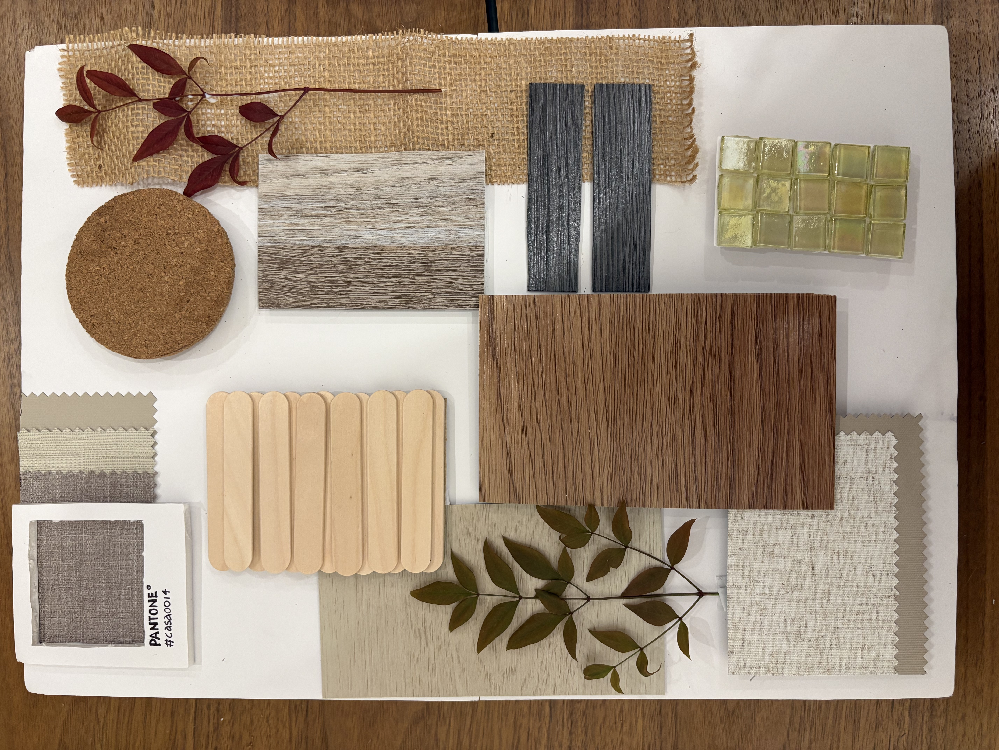

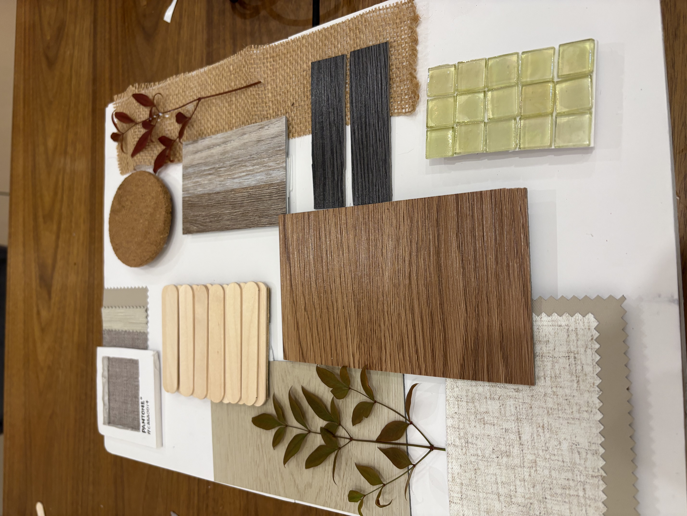

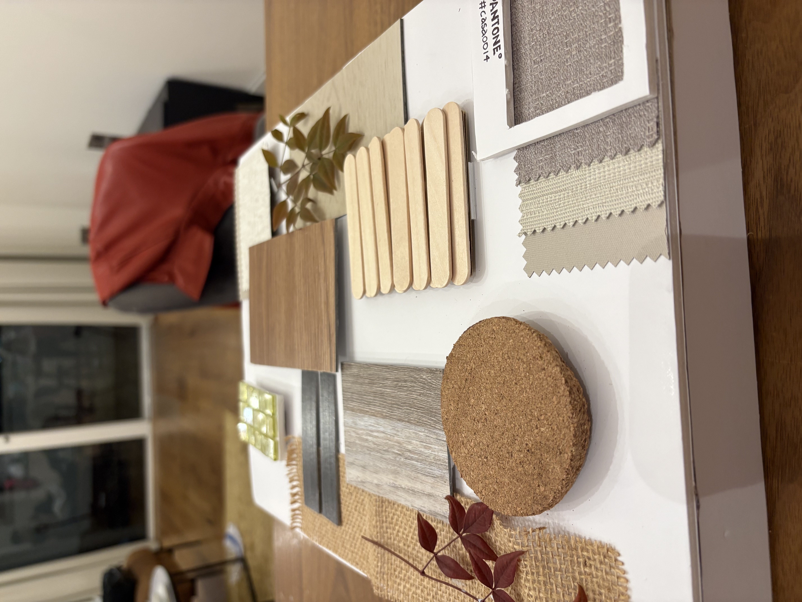

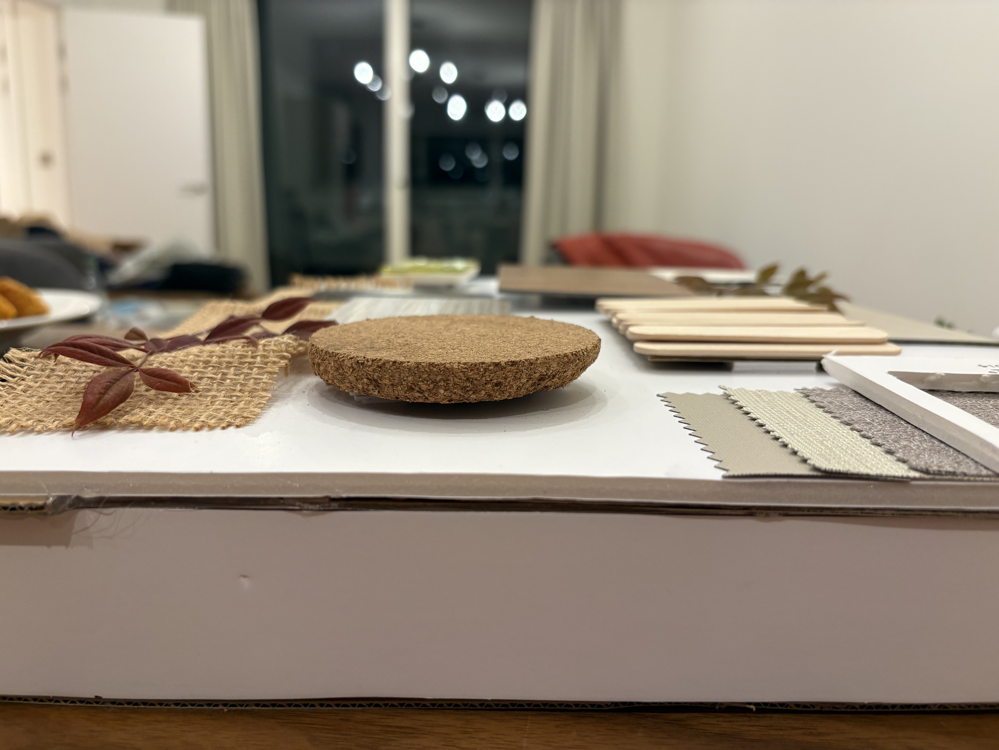

*CASA0014 Connected Environments · UCL · Arduino MKR WiFi 1010 → MQTT → Vespera*

## Concept
**Early concept sketch: layered material samples, with the leaf and textiles as decorative accents**
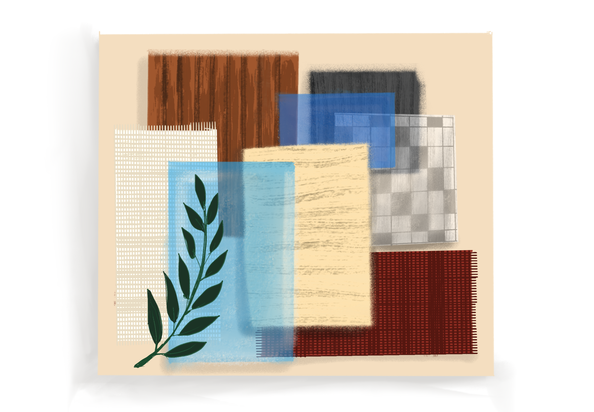

## Inspiration
I am very familiar with moodboards, due to a lot of designing. Initial idea was to make an interactive artwork, with many layers/levels creating depth, but it was clumsy and i wanted to make something with two levels maximum and more importantly, something really useful, or that factor that could be of some direction in the future, thus, while i was working on placing the placeholders, and voila! why don't i just make a real life moodboard and complement colors with it! 
But, it made more sense if one could actually view materials in a desired lighting while one is out shopping for interior design materials, or just takinga. stroll through furniture. Because every material is distinct to its own way of experiencing under different tones of light. 

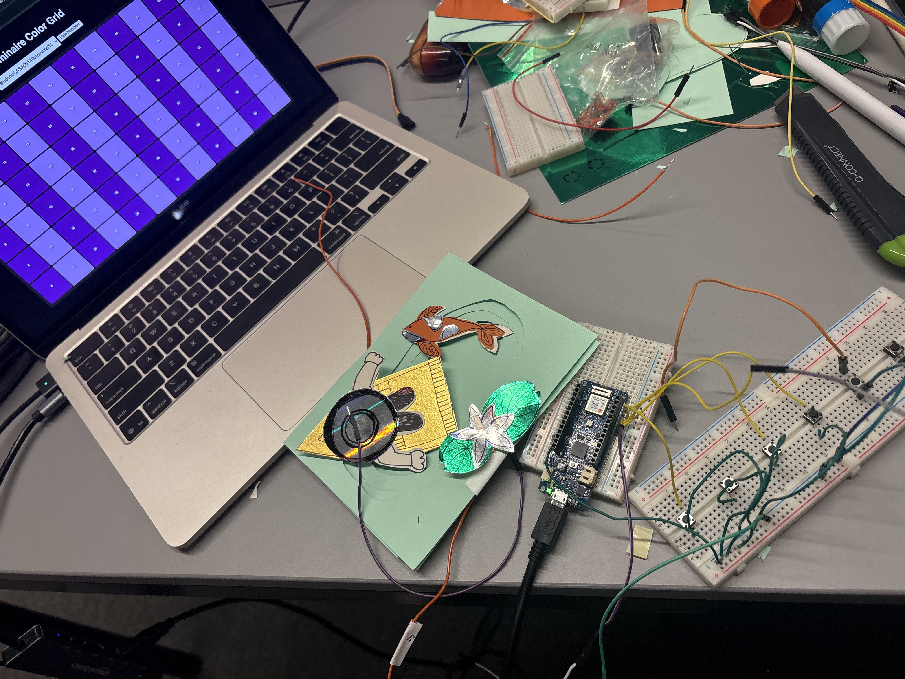

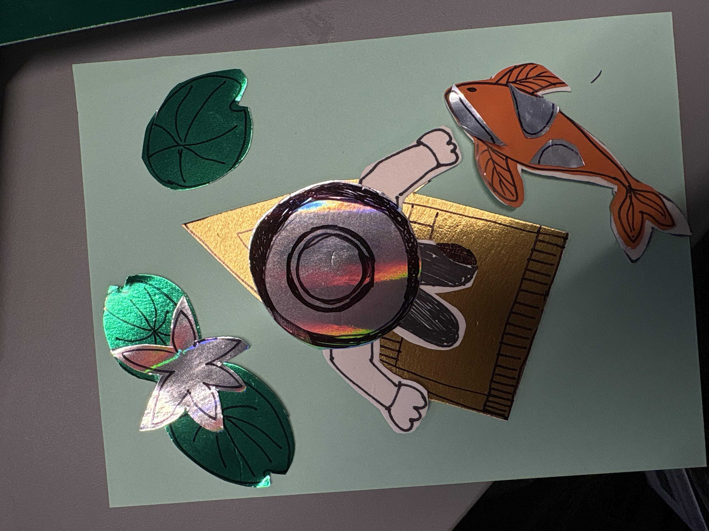

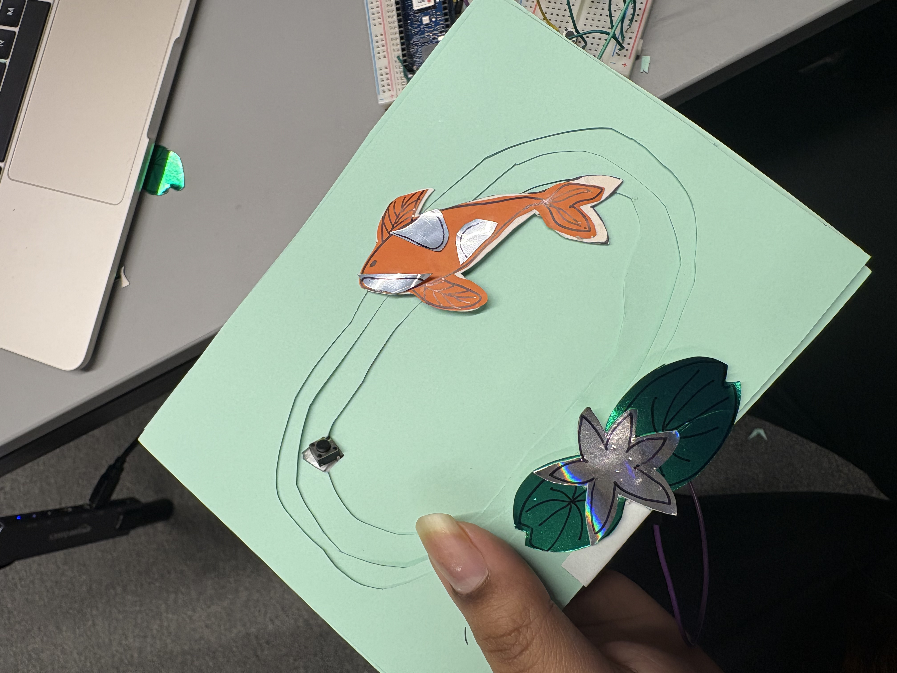

## PIVOT TO

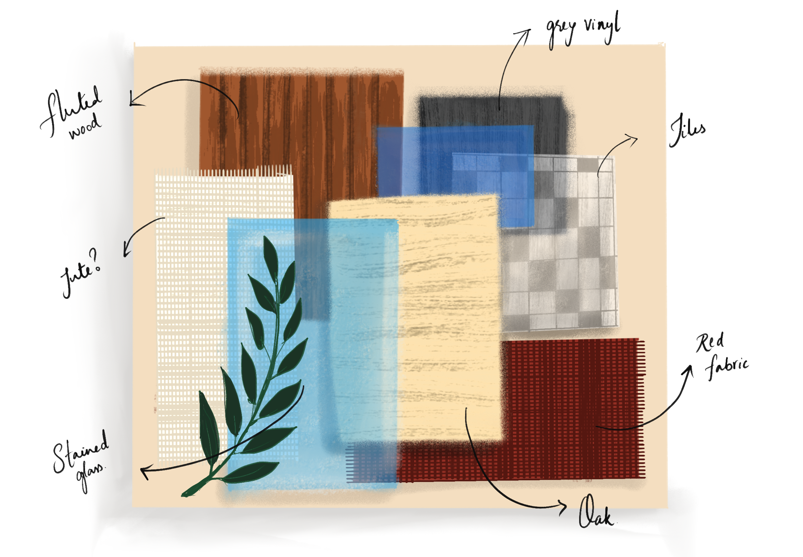

**Diagrams:** [Concept](docs/diagrams/concept.jpg) · [System](docs/diagrams/system_diagram.png) · [Wiring](docs/diagrams/wiring_diagram.png)

## How it works
1. Six material tiles float on hidden push buttons.
2. When nothing is pressed, Vespera shows the board's palette (two columns per material).
3. Pressing a tile shows that material's light scene/ Color of the material.
4. After 60 seconds with no press, Vespera returns to the palette.

The MKR1010 builds a 72-LED frame (216 bytes of RGB) and publishes it to `student/CASA0014/luminaire/15` on `mqtt.cetools.org`, only when the frame changes.

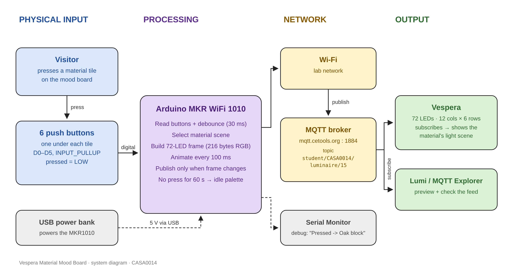

## Hardware
| Component | Purpose |
|-----------|---------|
| Arduino MKR WiFi 1010 | Reads the buttons, publishes to MQTT over Wi-Fi |
| 6 tactile push buttons | One under each interactive material tile |
| Hook-up wire, solder, heat-shrink, hot glue | Soldered button connections |
| White foam board (4 × A4), cardboard, craft sticks | Base, spacers and tile posts |
| Material samples | Fluted wood, grey oak, blue glass, oak, silver mosaic, fabric + decorative pieces |
| USB power bank | Portable power |

## Wiring
| Tile | Material | MKR pin |
|------|----------|---------|
| 1 | Cork | D1 |
| 2 | Warm wood | D2 |
| 3 | Fluted wood | D3 |
| 4 | Oak | D4 |
| 5 | Glass mosaic | D5 |
| 6 | Fabric | D0 |
| – | Shared ground (all buttons) | GND |

- Each button: one leg → its pin, the **diagonal** leg → GND (legs on the same side are joined inside the button).
- `INPUT_PULLUP`, so no resistors are needed.
- Pin 6 is avoided: it drives the MKR1010's built-in LED.
- Wires: orange and red hook-up wire, labelled B1–B6 at the breadboard end.

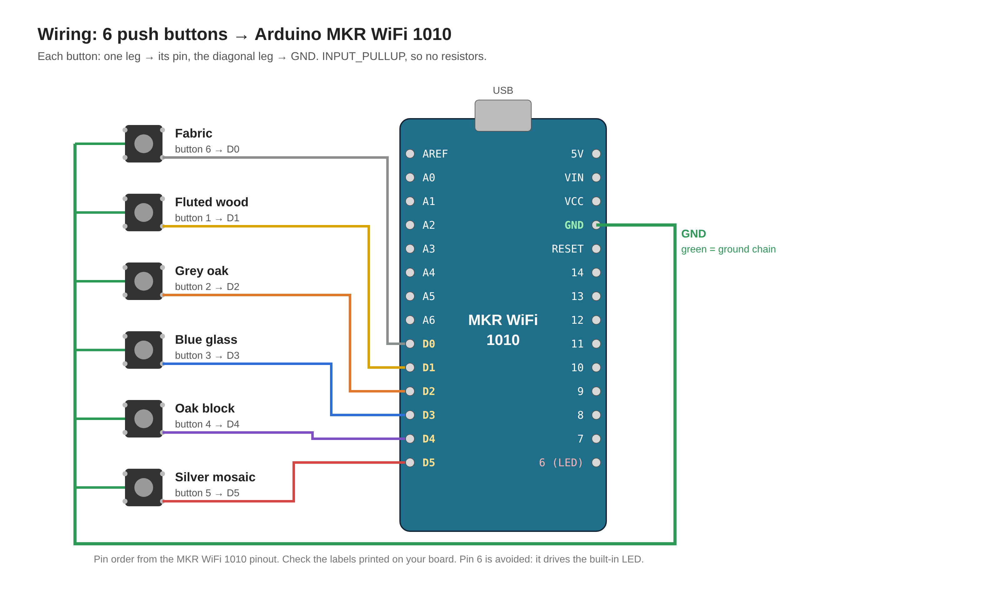

## Iterations
| Version | What changed |
|---------|--------------|
| FACE ID idea | vision board is tough to deal with in given time |
| [v3](sketches/v3_pond_controller/) | Paper pond, 5 buttons, moving boat stripes |
| [v4](sketches/v4_pond_controller/) | 6th button, two-tone colours |
| Soldering | Moved from breadboard to soldered buttons |
| [v5](sketches/v5_mood_board/) | Material mood board, idle palette, 60 s timeout, moving mosaic |

## Testing
See [tests/](tests/) and the [devlog](docs/devlog.md).
All my trials and errors, and bugs, fixes, prototyping mishaps, soldering issues and all the fun stuff about process and the making of this real life moodboard is in there (devlog & tests)

## Reflection and future work
I would really love to see retail spaces acquiring such a concept, very personalised, very spatially enhancing experience!

## Getting started
1. Open `sketches/v5_mood_board/v5_mood_board.ino` in the Arduino IDE and select **Arduino MKR WiFi 1010**.
2. Install the libraries **WiFiNINA** and **PubSubClient**.
3. Copy `arduino_secrets.example.h` to `arduino_secrets.h` in the same folder and fill in your Wi-Fi and MQTT details. Never commit it.
4. Change `lightId` to Vespera number.
5. Wire the buttons as above and upload.

## Repository structure
| Folder | Contents |
|--------|----------|
| [sketches/](sketches/) | v3, v4 and v5 Arduino sketches |
| [tests/](tests/) | Test sketches and results |
| [docs/diagrams/](docs/diagrams/) | Concept, system and wiring diagrams |
| [docs/photos/](docs/photos/) | Build and prototype photos |
| [docs/devlog.md](docs/devlog.md) | Dated development log |

## AI use
**Claude (Anthropic)** – Assisted in logic drafting, complex code like glint and debugging, diagrams, documentation structure 
**What AI helped with**
- Drafted the sketch framework: button debouncing, non-blocking frame timer,
 the Boat/oak stripe animation, and the v5 structure
  (idle palette, 60 s timeout, moving mosaic)
- Generated the system and wiring diagrams in docs/diagrams/
- Suggested the README structure and starting RGB values
  
**What I did**
- Concept and pivots (FACE ID → pond → material mood board) and the material selection
- All wiring, soldering and the physical build
- Found the diagonal-leg button fault through testing
- Tested colours on Lumi and the real Vespera and chose the final values
- Wrote the concept, reflection and devlog
- Built prototypes and finally made the final decent looking moodboard controller

## Future use
- Room-scale ambient lighting that responds to the materials being viewed
- Real colour temperature (2700K–6500K) using tunable-white LEDs, since RGB LEDs can’t produce warm white or grey
- A showroom version: scan or tap any sample to see it under its intended lighting
- Logging which materials visitors press, so designers learn what people are drawn to

## Licence
MIT
