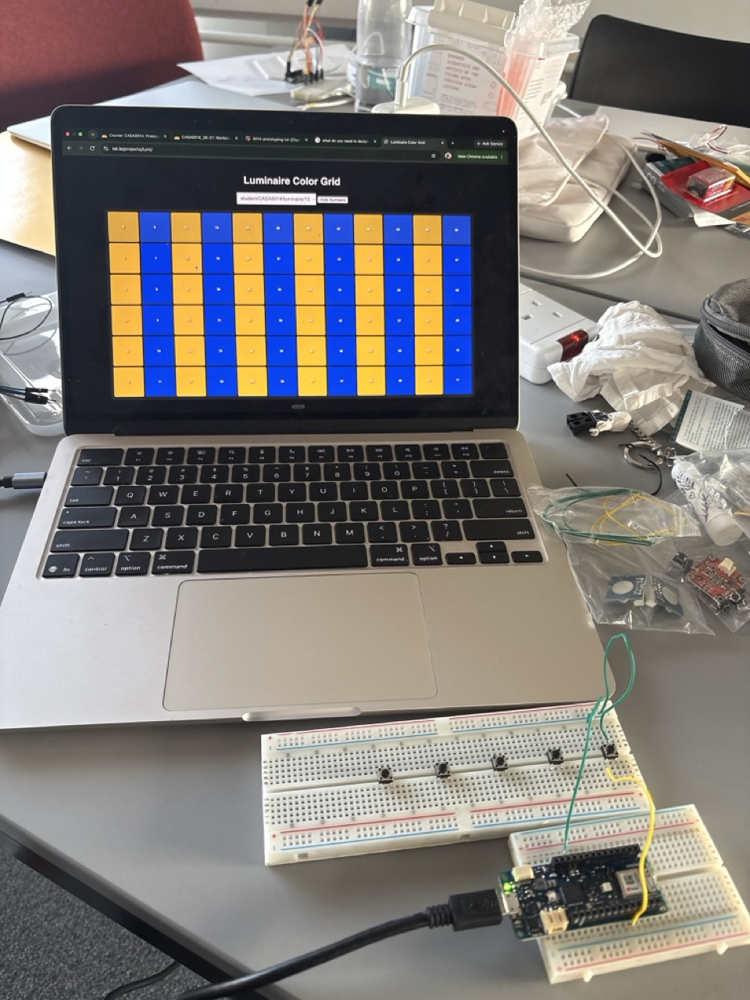
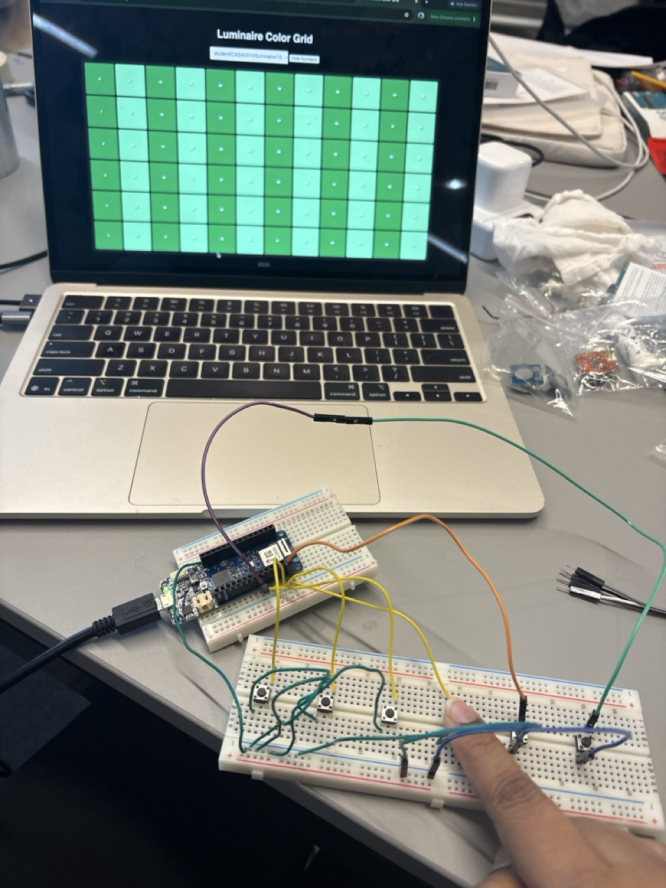
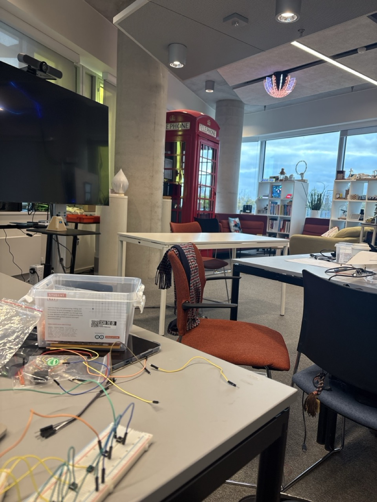

# Devlog — Vespera Pond Controller

## 2026-10-28
**Did:**
- Wired 5 push buttons on a breadboard
- Button 1 → Boat animation working on Vespera (topic 15)

**Problems:**
- Buttons weren't across the centre gap
- GND wire one row off (in VCC instead of GND)
- Buttons 2–5 had no GND wire
- Rail split at row 30

**Fixes:**
- 

**Next:**
- Solder 2 buttons and test with button_test

## 2026-10-28 — 5 buttons working

### Setup
- Created repo `vespera_controller`; moved it out of iCloud Drive to `~/Github` (iCloud was syncing the `.git` folder)
- Fixed sketch folder naming (Arduino needs folder name = sketch name; Save As without `.ino`)
- Copied `arduino_secrets.h` from my working `vespera_test` sketch; `.gitignore` excludes it

### Breadboard iteration
- Wired 5 tactile push buttons → MKR1010 pins 1–5, INPUT_PULLUP (no resistors)
- Button 1 → Boat animation worked on Lumi **and the physical Vespera** (topic 15)
- Problems found:
  - Buttons were on one side of the breadboard instead of straddling the centre gap
  - GND wire was one row off (in VCC's row instead of GND)
  - Buttons 2–5 had a signal wire but no GND wire
  - GND rail is split around row 30, so the top half wasn't grounded
  - Added a VCC wire by mistake — removed it; not needed with INPUT_PULLUP and risked a short
- Test: moved button 1's wire to pin 2 → Flowers appeared, proving pin 2 and the code worked → fault was wiring, not code

### Finding: Vespera / Lumi layout
- 72 LEDs = 12 columns × 6 rows, numbered **down each column** (0–5 = column 1)
- column = i / 6, row = i % 6 → stripeWidth 6 gives exactly one column per stripe

### Soldering iteration (prof's suggestion)
- Soldered wires directly to the buttons
- **Root cause of buttons not working:** wires were on two legs of the same internal pair
  (always connected), not the switch pair
- **Fix:** soldered to **diagonal legs** → all 5 buttons work
- Wrote `tests/button_test` to show live pin states without WiFi/MQTT

### What I learned
- (write in your own words)

### Next
- [ ] Animate Flowers, Koi, Lily pads, Water (currently static placeholders)
- [ ] Build the paper pond and fit the buttons under the scene

### v4 — 6th button + colour update
- Kept v3 unchanged as Iteration 1; new sketch `sketches/v4_pond_animations`
- Added button 6 → Purple lotus on **pin 0** 
- Colours, alternating by column using `colOf(i) % 2`:
  - Lily pads: dark green (40,160,70) / pastel green (120,220,140)
  - Water: dark blue (0,30,120) / light blue (80,180,205)
  - Purple lotus: dark purple (120,0,160) / light purple (200,140,255)
  - Koi: orange (255,100,20) with cream patches (255,230,180)
- Boat stays the only animated pattern
- Tested all 6 buttons on Lumi + physical Vespera → video recorded

