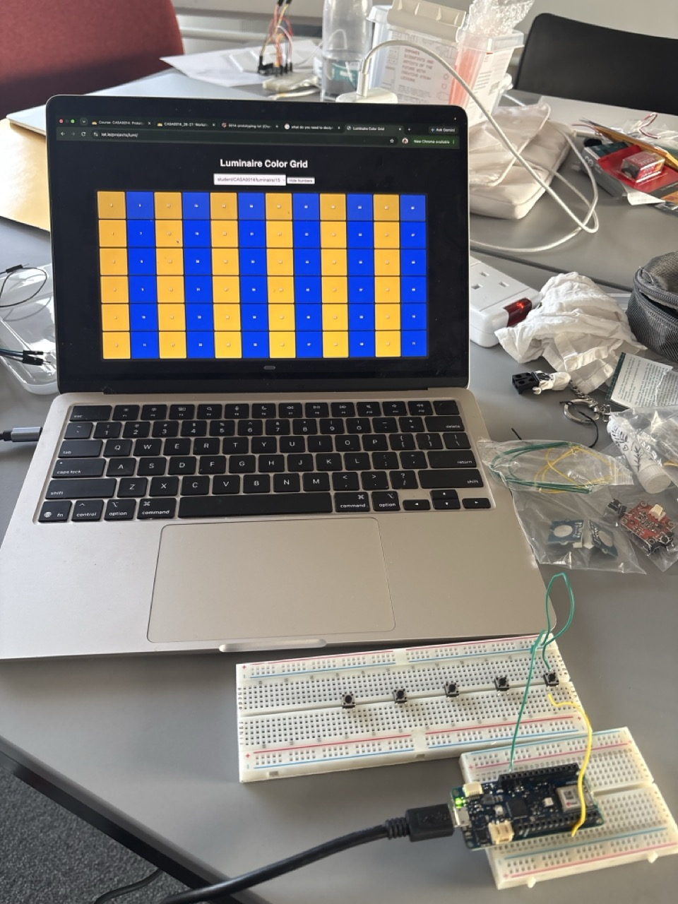
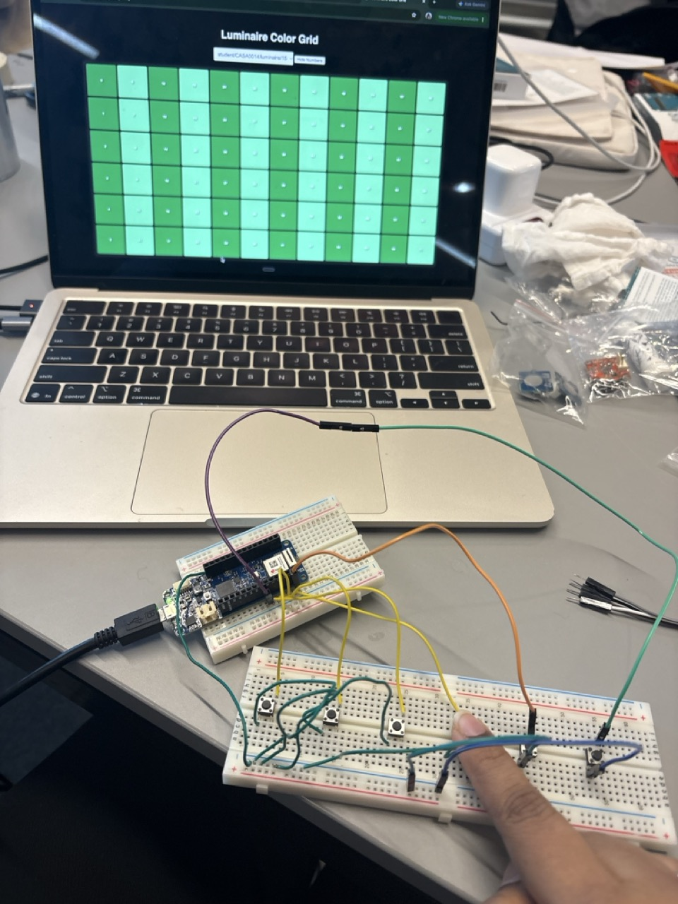
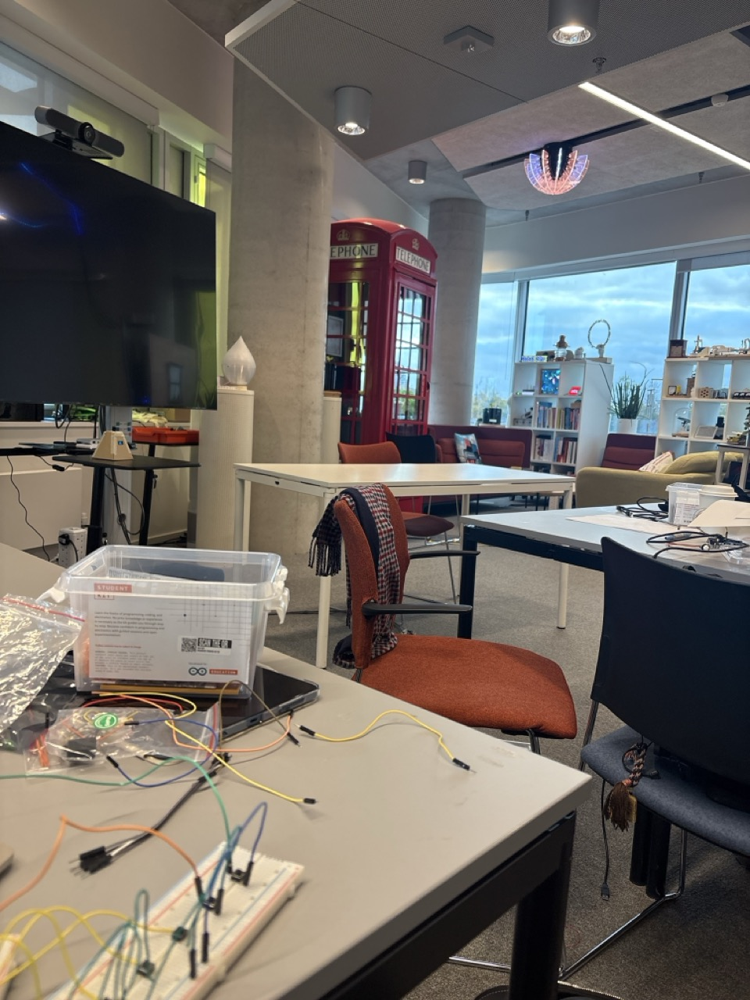
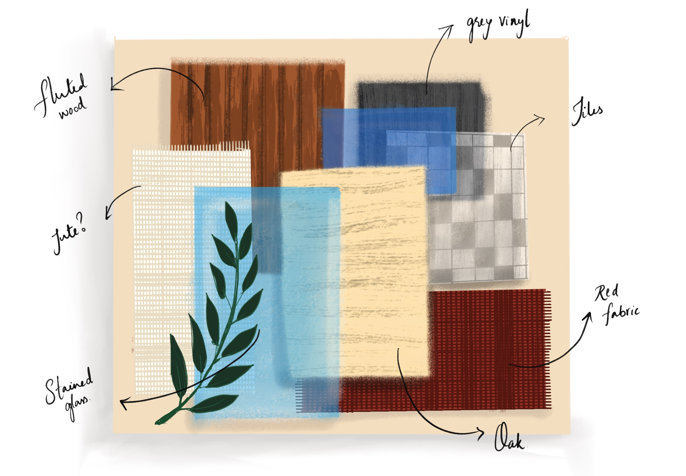
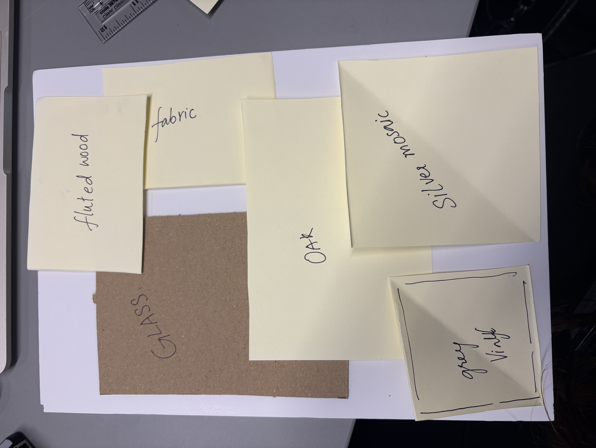
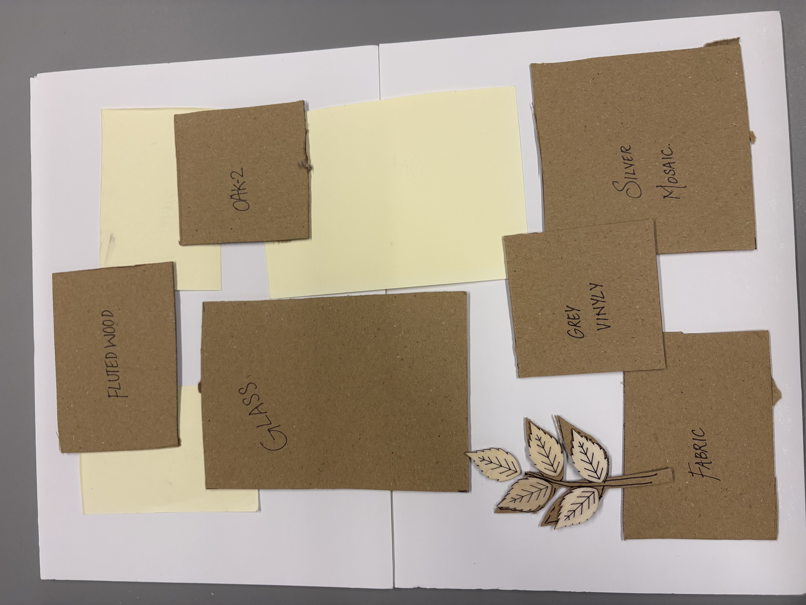
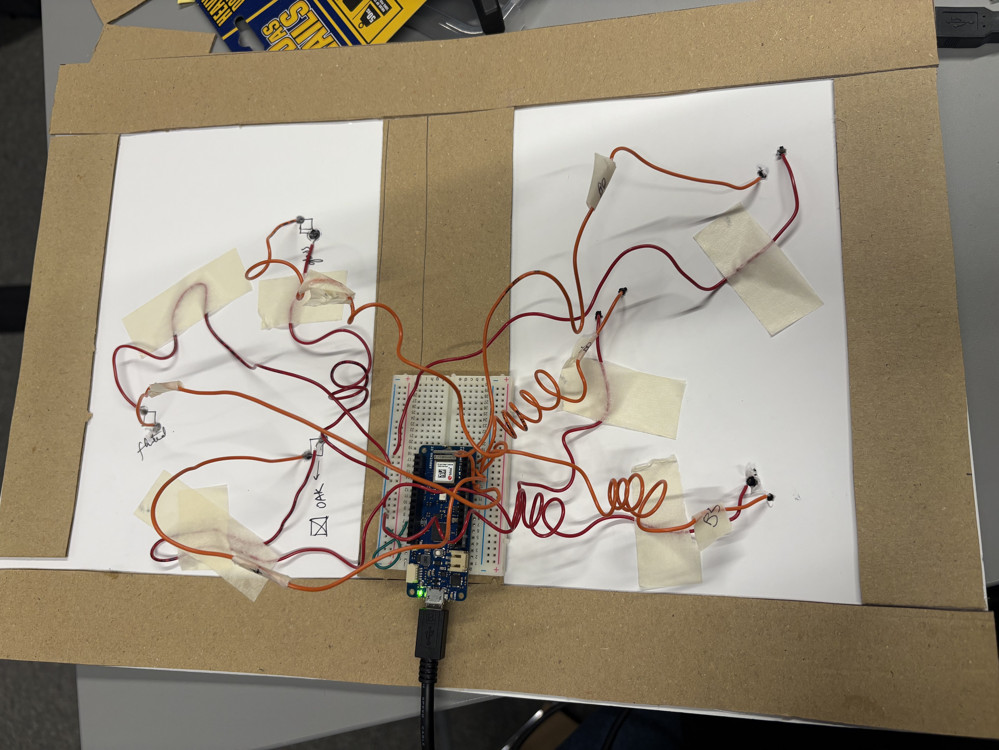
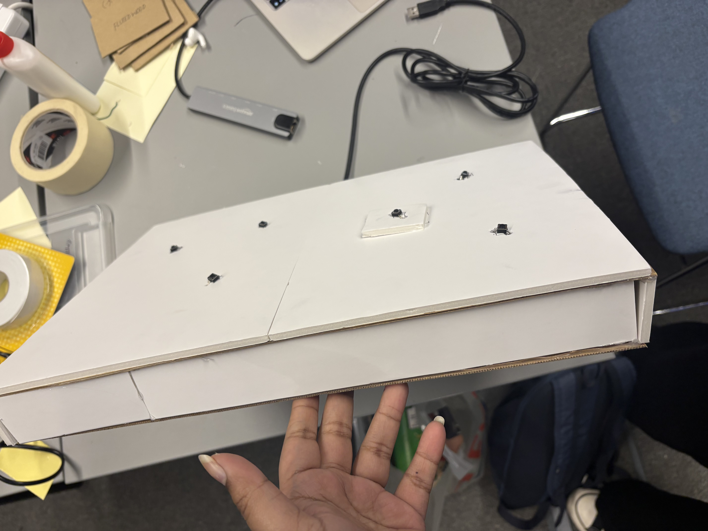
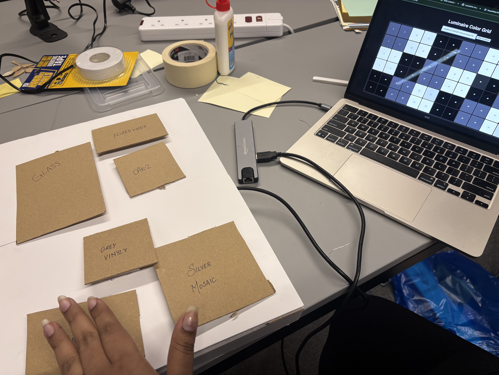

# Devlog — Vespera Pond Controller --> Material mood board

## 2026-10-28
**Did:**
- Wired 5 push buttons on a breadboard
- Button 1 → Boat animation working on Vespera (topic 15)

**Problems:**
- Buttons weren't across the centre gap
- GND wire one row off (in VCC instead of GND)
- Buttons 2–5 had no GND wire
- Rail split at row 30

**Fixes:**
- 

**Next:**
- Solder 2 buttons and test with button_test

## 2026-10-28 — 5 buttons working

### Setup
- Created repo `vespera_controller`; moved it out of iCloud Drive to `~/Github` (iCloud was syncing the `.git` folder)
- Fixed sketch folder naming (Arduino needs folder name = sketch name; Save As without `.ino`)
- Copied `arduino_secrets.h` from my working `vespera_test` sketch; `.gitignore` excludes it

### Breadboard iteration
- Wired 5 tactile push buttons → MKR1010 pins 1–5, INPUT_PULLUP (no resistors)
- Button 1 → Boat animation worked on Lumi **and the physical Vespera** (topic 15)
- Problems found:
  - Buttons were on one side of the breadboard instead of straddling the centre gap
  - GND wire was one row off (in VCC's row instead of GND)
  - Buttons 2–5 had a signal wire but no GND wire
  - GND rail is split around row 30, so the top half wasn't grounded
  - Added a VCC wire by mistake — removed it; not needed with INPUT_PULLUP and risked a short
- Test: moved button 1's wire to pin 2 → Flowers appeared, proving pin 2 and the code worked → fault was wiring, not code

### Finding: Vespera / Lumi layout
- 72 LEDs = 12 columns × 6 rows, numbered **down each column** (0–5 = column 1)
- column = i / 6, row = i % 6 → stripeWidth 6 gives exactly one column per stripe

### Soldering iteration (prof's suggestion)
- Soldered wires directly to the buttons
- **Root cause of buttons not working:** wires were on two legs of the same internal pair
  (always connected), not the switch pair
- **Fix:** soldered to **diagonal legs** → all 5 buttons work
- Wrote `tests/button_test` to show live pin states without WiFi/MQTT

### Next
- [ ] Animate Flowers, Koi, Lily pads, Water (currently static placeholders)
- [ ] Build the paper pond and fit the buttons under the scene

### v4 — 6th button + colour update
- Kept v3 unchanged as Iteration 1; new sketch `sketches/v4_pond_animations`
- Added button 6 → Purple lotus on **pin 0** 
- Colours, alternating by column using `colOf(i) % 2`:
  - Lily pads: dark green (40,160,70) / pastel green (120,220,140)
  - Water: dark blue (0,30,120) / light blue (80,180,205)
  - Purple lotus: dark purple (120,0,160) / light purple (200,140,255)
  - Koi: orange (255,100,20) with cream patches (255,230,180)
- Boat stays the only animated pattern
- Tested all 6 buttons on Lumi + physical Vespera → video recorded

## 2026-10-31 — Repo clean-up
- Pushed v3 and v4 sketches, button test sketch, photos and this devlog

## 2026-11-02 — Pivot: pond → material mood board (v5)

### Why I changed the concept
- Koi pond was fun, but i needed a use case scenario, hence i pivoted to making a real material moodboard that could have its own ambient lighting, to 1. view different materials in various tones of light to check what complements it 2. to check if light enhances the depth of the material. 
### Design
- 6 interactive material tiles on hidden buttons: fluted wood, grey oak, blue glass,
  oak block, silver mosaic, fabric
- Decorative layer glued flat underneath: jute, lace, marbled paper, watercolour, wooden leaves
- Scheme: warm woods, terracotta, linen, blue glass, silver mosaic

- Paper and cardboard mock-ups to test layouts: A3 landscape looked scattered → thus, portrait cluster

- Tried a two-level layout (overlapping tiles on risers) 
  layering now comes from flat decorative pieces peeking out under the tiles
  and one tile for the second layer
- Kept interactive tiles because why not!

### Code (v5)
- Modes renamed to materials; main colours stored once in palette[6][3]
- Idle state: Vespera shows the board's palette, 2 columns per material
- 60 s with no press → back to the palette
- Silver mosaic: three tones (silver / cream / near-black), shifting diagonally, with glints

### Colour testing (Lumi + Vespera)
- First palette (browns, greys, creams from the samples) looked almost identical on the LEDs
- RGB LEDs can't show brown or grey: brown → dim orange, grey → dim white
- Moved to stronger, separate hues: brown, cool grey, deep blue, yellow, white, terracotta
- Grey oak given a high-contrast light/slate pattern so it stands out
- Trade-off: colour accuracy vs telling materials apart → chose legibility
- What I learned: The more complex I get with the colors, the lights dont show the depth.
- The room needs to be dark inorder for the color to be visible, otherwise its a light shade
- Also the shape of the vespera, for a project with complex colors or for any project with a visualisation depth, a linear placement of lights is better/ elements showcasing need to be simple.

### Build (evening)
- Base: 2 × A4 foam board (5 mm) joined into portrait A3
- Cardboard frame around the edge + centre spine along the join for stiffness (4cm on the edges and 5cm in the center for spin like grip because the elements are heavy)
- 6 soldered buttons glued face-up at each tile position, wires through holes to the back
- Breadboard + MKR1010 fixed on the centre spine, USB out of the left edge
- Wires labelled (B1–B6, GND) and taped flat

- Side walls (~35–40 mm) so the board rests on the walls, not on the Arduino
 
- Press test with cardboard placeholder tiles: all 6 buttons changed Lumi correctly
 
- Problem: Soldered wires kept falling off, had to solder again and again. Had to handle a little gently and put a lot of logic and thought behind mounting the buttons onto the foam board.
### SKELETON VIDEO
 
### Docs
- Added system and wiring diagrams, concept sketch, photos, secrets template, tests README, README structure

### Next
- [ ] Corner posts under each tile
- [ ] Real samples on (arriving Tue)
- [ ] Final photos, finish README sections, upload screenshot PDF to Moodle

## 2026-11-03 — Real materials and final build

### Materials
- Waited for the Amazon delivery (vinyl wood samples, glass mosaic, fabric)
- Cork: repurposed an IKEA cork trivet (pot / heat-pad holder)
- Fluted wood: made by hand from craft sticks
- Blue glass dropped: the sample was too heavy for a tile resting on a small tactile button
  the button did not push back up despite many ways of supporting it → changes the orientation of the moodboard, added wood, and cork instead

### Build
- Final tiles on the A3 board (2 × A4 foam board), each over its button
- Decorative layer: jute, and leaves, Pantone-style label
- Tested every tile with button_test with the real materials on: (result)

### Code
- Remapped tiles to pins: Cork D1, Warm wood D2, Fluted wood D3, Oak D4, Glass mosaic D5, Fabric D0
- New light scenes matched to the real samples (cork, warm wood, fluted rows, oak stripes,
  glass mosaic shimmer + glints, fabric)
